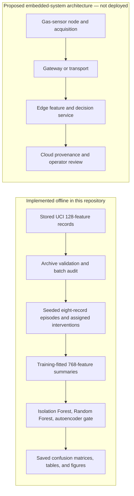

# Course report and slide text — frozen experiment

## Methodology (report-ready)

We evaluated a controlled simulation on the UCI Gas Sensor Array Drift at Different Concentrations dataset, which supplies 128 extracted sensor features per record. **The implemented system is an offline Python pipeline.** It validates the pinned archive and its ten-batch layout, parses the features, audits source coverage, constructs paired synthetic episodes, builds numeric summaries, fits the prespecified models, and saves aggregate evaluation reports. No sensor node, gateway, edge runtime, cloud service, or actuation path was built or benchmarked.

Two evidence tracks have different meanings. Track A compares later records with a Batch 1 reference envelope only where gas and exact concentration match; 3,834 of 7,977 Batch 7–10 records qualify. An outside-envelope record is a reference departure, not a verified aging event. Track B groups distinct source records into eight-record base episodes within one batch, gas, and exact concentration. A seeded shuffle sets their order; the dataset provides no acquisition timestamps or real intervention onset. The 342 training, 282 validation, and 909 test base episodes from Batches 2–10 each yield an unmodified background, a gradual synthetic gain ramp, and one assigned attack variant. The attack families are bias, scaling, noise, freeze, and replay. Variants share source rows, and only one selected eight-feature sensor block changes at zero-based positions 5–7. Freeze and replay are exact-copy controls with construction signatures.

Feature and generator scales use unmodified Batches 1–4 only. For each episode, six summaries per feature describe the pre-intervention level, active-minus-pre level, onset step, active slope, active variation, and lag-four similarity, producing 768 numeric inputs. Gas, concentration, batch, source IDs, and generator parameters remain audit metadata, not direct model inputs. The primary bias magnitude is drawn from frozen Batch 2–4 training-derived drift-magnitude pools; the original bias grid is reported separately as a stress condition. This is distributional calibration with residual mismatch, not exact per-episode matching.

Isolation Forest fits Batch 2–4 background summaries and gives a **binary** background-versus-intervention decision after threshold selection on Batches 5–6. Random Forest fits Batch 2–4 three-class variants; its settings are selected on Batches 5–6 and its class prediction is the single-stage result. The autoencoder fits 348 unmodified Batch 1–4 episode summaries, applies its separately fitted normalization, and selects its binary score threshold on Batches 5–6. In the gated comparison, an AE score at or below threshold gives background; above threshold, the fitted forest chooses synthetic drift or synthetic attack by their probabilities, with a tie going to drift. All thresholds and settings stay fixed for Batches 7–10. Confusion matrices use true-label rows and predicted-label columns; macro-F1 averages class F1 values. Batches 7–10 are **exploratory** because their audit distributions were inspected before protocol freeze. Related variants and the two bias conditions share source episodes and are not independent replicates.

## Architecture figure brief (proposed versus implemented)

**Suggested report caption:** Implemented offline data flow and proposed sensing–gateway–edge–cloud placement, shown in separate lanes. The stored UCI features stand in for measurements; the proposal's hardware acquisition, communications, live inference, operator actions, latency, and resource use were not implemented or measured. A future edge service would need a valid timed input and an onset-independent design before deployment claims could be made.

## Proposal-to-implementation changes

| Proposal element | Implemented scope |
| --- | --- |
| AE trained on clean Batch 1 measurements | AE fitted on 348 unmodified Batch 1–4 episode summaries, only six from Batch 1. “Unmodified” is not independently verified healthy hardware. |
| Overall and per-sensor reconstruction evidence | One aggregate reconstruction score is used; no per-sensor score is reported. |
| RF consumes AE scores | RF consumes the 768 summaries; AE score gates the final decision after RF fitting. |
| Normal/drift/attack and accept/compensate/quarantine | Labels are background/synthetic drift/synthetic attack. Compensation and quarantine were neither implemented nor evaluated. |
| Real sensing/edge/cloud application | Offline feature-space simulation only; the embedded architecture above is a proposal. |

## Results narrative (report-ready)

Binary intervention detection and three-class classification answer different questions, so their macro-F1 scores should be shown in separate groups. In the matched-primary **exploratory test**, the saved results are:

| Task | Model | Macro-F1 | Background marked as an intervention |
| --- | --- | ---: | ---: |
| Binary | Isolation Forest | 0.4588 | 831/909 |
| Binary | Autoencoder | 0.4949 | 752/909 |
| Three-class | Random Forest | **0.3873** | **724/909** |
| Three-class | AE-gated Random Forest | **0.3694** | **752/909** |

The autoencoder has the higher saved binary macro-F1 than Isolation Forest, but it still flags 82.7% of background episodes. The AE gate **does not improve three-class macro-F1** over RF and increases background intervention flags from 79.6% to 82.7%. For RF, only **91/547 (16.6%)** bias, scaling, and noise attacks receive the correct attack label; **215/362** freeze and replay controls do. The latter exact-copy controls account for 215 of the 306 correctly classified attacks, so aggregate attack recall overstates performance on non-copy manipulations. These figures describe assigned feature transformations, not detection of real cyberattacks or natural sensor aging.

**Five-minute slide recommendation:** Use the four-row table above, visually divided by task, beside five small family bars labelled bias **30/184**, scaling **26/182**, noise **35/181**, freeze **98/181**, and replay **117/181** (RF matched-primary exploratory test). Shade freeze/replay as “exact-copy controls.” One preceding architecture slide should use the figure brief above and visibly mark its lower lane as proposed. Avoid an unlabeled pooled “attack accuracy” figure.

## Scope and reproducibility statement

The artificial episode order and known positions 5–7 make this an aligned offline episode classifier, not unknown-onset streaming detection. Later batches also differ in operating conditions: the saved manifest contains **zero** toluene training base episodes, **51** validation, and **146** test episodes. Gas and concentration are not direct model inputs but may be encoded indirectly in sensor values. High background false alarms, weak non-copy attack classification, and the AE gate's lack of three-class benefit limit the conclusions. No real aging or real attack labels, timed streams, deployed actions, resource measurements, or per-episode prediction exports are available.

The read-only verifier `scripts.verify_frozen` exits 0 in the restored local checkout, verifying all four external inputs and 34 frozen reports. An isolated Windows Python 3.13.16 environment passes the exact package gate, but the new run stopped on two last-digit preflight noise-median differences. Its baseline diagnostics also selected a different RF leaf size and produced different RF matrices. AE fitting and prediction export were not attempted after that divergence. Historical reports remain authoritative; no gas-specific error rates or per-episode predictions from this run are reported.
