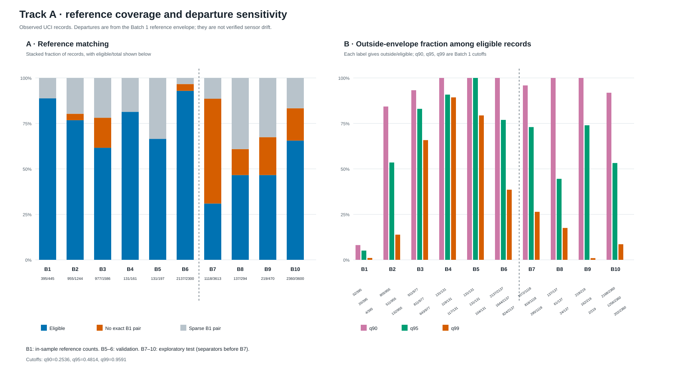
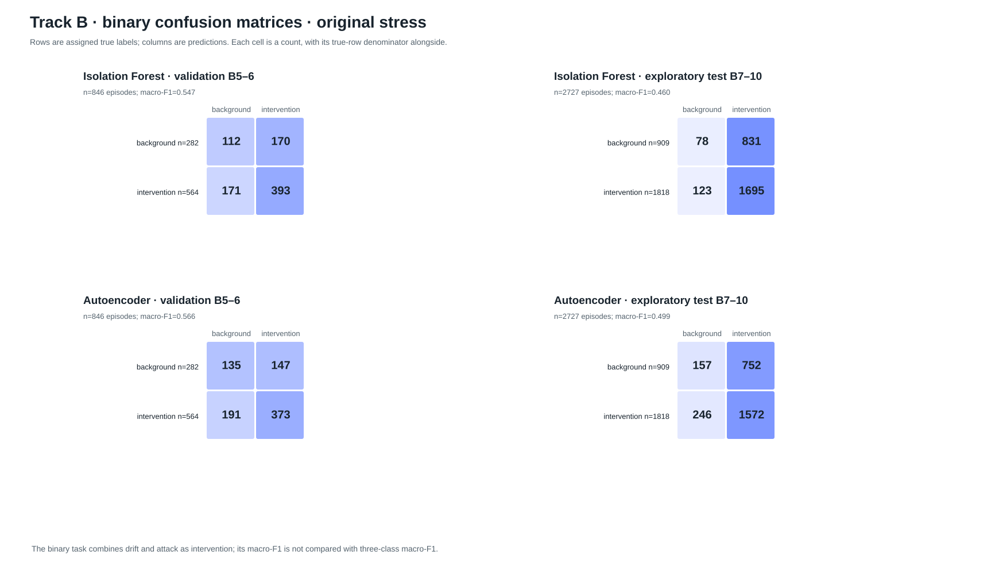
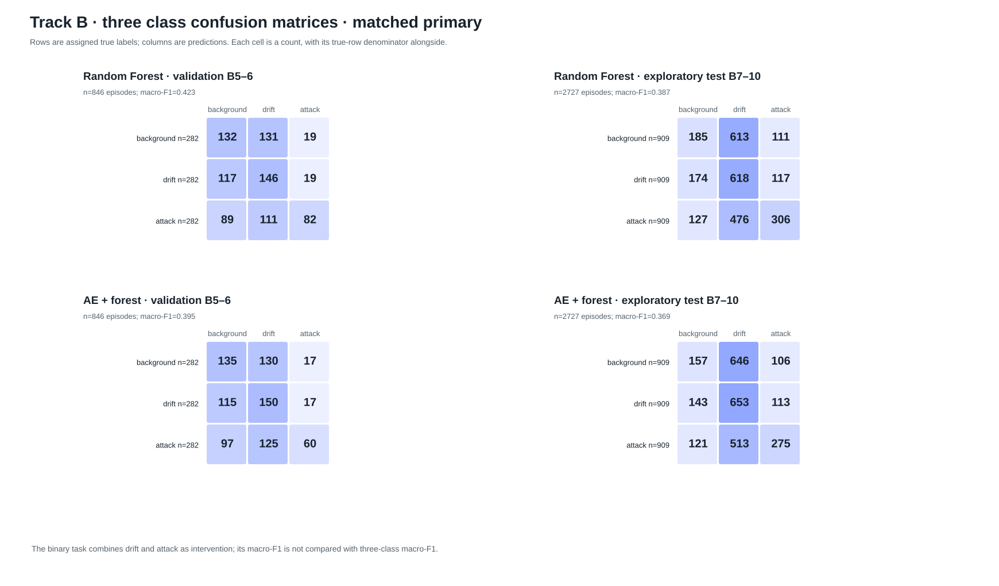
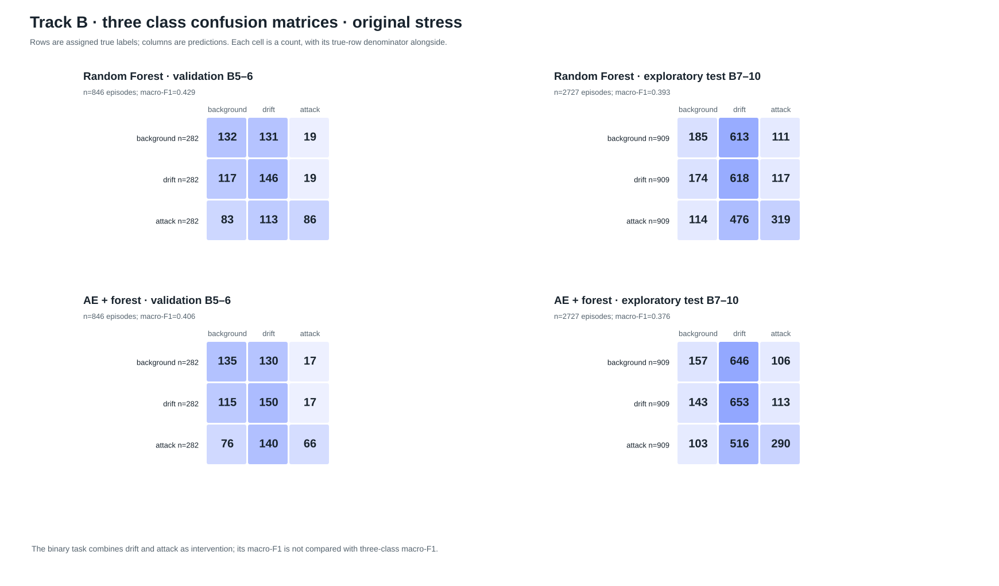
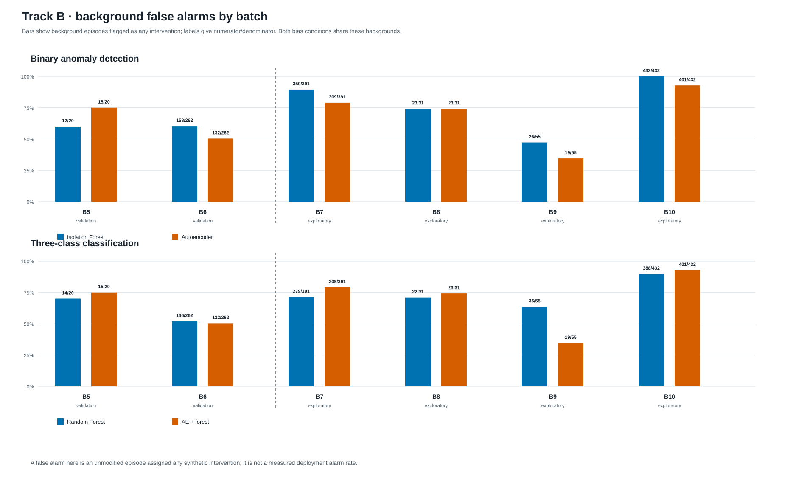
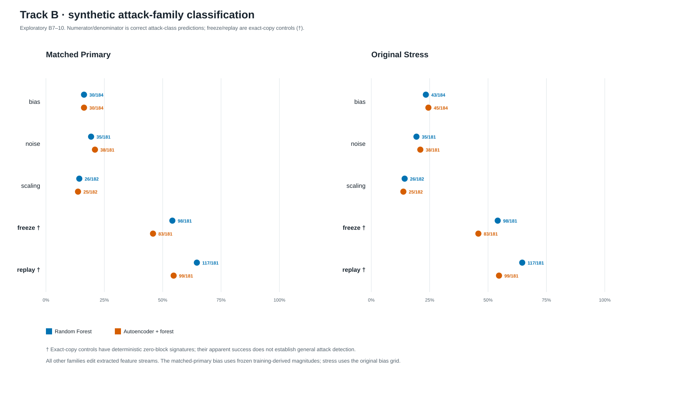

# Final results · Drift-or-Attack

These figures and tables are derived from frozen audit and model-result files. No predictions or thresholds were recomputed. **Batches 7–10 are exploratory:** their audit coverage and score distributions were inspected before the protocol was frozen.

## Track A · observational Batch 1 reference departures

Strict gas/concentration matching covers **3834/7977 (48.1%)** B7–10 records; 4143 are excluded. An outside-envelope record is a **reference departure**, not a verified natural-drift label. Batch 1 counts are in-sample reference counts and are not calibrated false-alarm estimates. Cutoffs (Batch 1 leave-one-out only): q90=0.253605, q95=0.481400, q99=0.959129.

| Batch | Role | Eligible / all | No exact B1 pair / all | Sparse B1 pair / all | Excluded / all | Outside q90 / eligible | Outside q95 / eligible | Outside q99 / eligible |
|---:|---|---:|---:|---:|---:|---:|---:|---:|
| 1 | reference | 395/445 | 0/445 | 50/445 | 50/445 | 32/395 | 20/395 | 4/395 |
| 2 | train | 955/1244 | 44/1244 | 245/1244 | 289/1244 | 805/955 | 511/955 | 132/955 |
| 3 | train | 977/1586 | 262/1586 | 347/1586 | 609/1586 | 911/977 | 811/977 | 643/977 |
| 4 | train | 131/161 | 0/161 | 30/161 | 30/161 | 131/131 | 119/131 | 117/131 |
| 5 | validation | 131/197 | 0/197 | 66/197 | 66/197 | 131/131 | 131/131 | 104/131 |
| 6 | validation | 2137/2300 | 86/2300 | 77/2300 | 163/2300 | 2137/2137 | 1644/2137 | 824/2137 |
| 7 | exploratory test | 1118/3613 | 2082/3613 | 413/3613 | 2495/3613 | 1072/1118 | 816/1118 | 295/1118 |
| 8 | exploratory test | 137/294 | 42/294 | 115/294 | 157/294 | 137/137 | 61/137 | 24/137 |
| 9 | exploratory test | 219/470 | 98/470 | 153/470 | 251/470 | 219/219 | 162/219 | 2/219 |
| 10 | exploratory test | 2360/3600 | 640/3600 | 600/3600 | 1240/3600 | 2168/2360 | 1256/2360 | 202/2360 |

Track A uses laboratory gas and concentration for exact reference matching. Unmatched and sparse strata receive no departure state. It supplies no cyberattack labels.

## Track B · controlled synthetic interventions

`background` means unmodified input, not verified healthy hardware. Binary detection and three-class classification are **different tasks**; their macro-F1 values are not compared directly. Primary and original-stress conditions share source episodes and are reported separately. All rates below show numerator/denominator.

### Binary anomaly detection

| Condition | Split | Model | Macro-F1 | Background false alarms | Drift detected | Attack detected |
|---|---|---|---:|---:|---:|---:|
| matched_primary | validation | Isolation Forest | 0.528 | 170/282 (60.3%) | 180/282 (63.8%) | 193/282 (68.4%) |
| matched_primary | validation | Autoencoder | 0.546 | 147/282 (52.1%) | 167/282 (59.2%) | 185/282 (65.6%) |
| matched_primary | exploratory test | Isolation Forest | 0.459 | 831/909 (91.4%) | 834/909 (91.7%) | 853/909 (93.8%) |
| matched_primary | exploratory test | Autoencoder | 0.495 | 752/909 (82.7%) | 766/909 (84.3%) | 788/909 (86.7%) |
| original_stress | validation | Isolation Forest | 0.547 | 170/282 (60.3%) | 180/282 (63.8%) | 213/282 (75.5%) |
| original_stress | validation | Autoencoder | 0.566 | 147/282 (52.1%) | 167/282 (59.2%) | 206/282 (73.0%) |
| original_stress | exploratory test | Isolation Forest | 0.460 | 831/909 (91.4%) | 834/909 (91.7%) | 861/909 (94.7%) |
| original_stress | exploratory test | Autoencoder | 0.499 | 752/909 (82.7%) | 766/909 (84.3%) | 806/909 (88.7%) |

Per-class precision and recall (P/R), with true-class support:

| Condition | Split | Model | Class | Precision | Recall | Support |
|---|---|---|---|---:|---:|---:|
| matched_primary | validation | Isolation Forest | background | 0.370 | 0.397 | 282 |
| matched_primary | validation | Isolation Forest | intervention | 0.687 | 0.661 | 564 |
| matched_primary | validation | Autoencoder | background | 0.389 | 0.479 | 282 |
| matched_primary | validation | Autoencoder | intervention | 0.705 | 0.624 | 564 |
| matched_primary | exploratory test | Isolation Forest | background | 0.373 | 0.086 | 909 |
| matched_primary | exploratory test | Isolation Forest | intervention | 0.670 | 0.928 | 1818 |
| matched_primary | exploratory test | Autoencoder | background | 0.373 | 0.173 | 909 |
| matched_primary | exploratory test | Autoencoder | intervention | 0.674 | 0.855 | 1818 |
| original_stress | validation | Isolation Forest | background | 0.396 | 0.397 | 282 |
| original_stress | validation | Isolation Forest | intervention | 0.698 | 0.697 | 564 |
| original_stress | validation | Autoencoder | background | 0.414 | 0.479 | 282 |
| original_stress | validation | Autoencoder | intervention | 0.717 | 0.661 | 564 |
| original_stress | exploratory test | Isolation Forest | background | 0.388 | 0.086 | 909 |
| original_stress | exploratory test | Isolation Forest | intervention | 0.671 | 0.932 | 1818 |
| original_stress | exploratory test | Autoencoder | background | 0.390 | 0.173 | 909 |
| original_stress | exploratory test | Autoencoder | intervention | 0.676 | 0.865 | 1818 |

### Three-class classification

| Condition | Split | Model | Macro-F1 | Background false alarms | Drift→attack | Attack→background/drift |
|---|---|---|---:|---:|---:|---:|
| matched_primary | validation | Random Forest | 0.423 | 150/282 (53.2%) | 19/282 (6.7%) | 200/282 (70.9%) |
| matched_primary | validation | AE + forest | 0.395 | 147/282 (52.1%) | 17/282 (6.0%) | 222/282 (78.7%) |
| matched_primary | exploratory test | Random Forest | 0.387 | 724/909 (79.6%) | 117/909 (12.9%) | 603/909 (66.3%) |
| matched_primary | exploratory test | AE + forest | 0.369 | 752/909 (82.7%) | 113/909 (12.4%) | 634/909 (69.7%) |
| original_stress | validation | Random Forest | 0.429 | 150/282 (53.2%) | 19/282 (6.7%) | 196/282 (69.5%) |
| original_stress | validation | AE + forest | 0.406 | 147/282 (52.1%) | 17/282 (6.0%) | 216/282 (76.6%) |
| original_stress | exploratory test | Random Forest | 0.393 | 724/909 (79.6%) | 117/909 (12.9%) | 590/909 (64.9%) |
| original_stress | exploratory test | AE + forest | 0.376 | 752/909 (82.7%) | 113/909 (12.4%) | 619/909 (68.1%) |

Per-class precision and recall (P/R), with true-class support:

| Condition | Split | Model | Class | Precision | Recall | Support |
|---|---|---|---|---:|---:|---:|
| matched_primary | validation | Random Forest | background | 0.391 | 0.468 | 282 |
| matched_primary | validation | Random Forest | synthetic_drift | 0.376 | 0.518 | 282 |
| matched_primary | validation | Random Forest | synthetic_attack | 0.683 | 0.291 | 282 |
| matched_primary | validation | AE + forest | background | 0.389 | 0.479 | 282 |
| matched_primary | validation | AE + forest | synthetic_drift | 0.370 | 0.532 | 282 |
| matched_primary | validation | AE + forest | synthetic_attack | 0.638 | 0.213 | 282 |
| matched_primary | exploratory test | Random Forest | background | 0.381 | 0.204 | 909 |
| matched_primary | exploratory test | Random Forest | synthetic_drift | 0.362 | 0.680 | 909 |
| matched_primary | exploratory test | Random Forest | synthetic_attack | 0.573 | 0.337 | 909 |
| matched_primary | exploratory test | AE + forest | background | 0.373 | 0.173 | 909 |
| matched_primary | exploratory test | AE + forest | synthetic_drift | 0.360 | 0.718 | 909 |
| matched_primary | exploratory test | AE + forest | synthetic_attack | 0.557 | 0.303 | 909 |
| original_stress | validation | Random Forest | background | 0.398 | 0.468 | 282 |
| original_stress | validation | Random Forest | synthetic_drift | 0.374 | 0.518 | 282 |
| original_stress | validation | Random Forest | synthetic_attack | 0.694 | 0.305 | 282 |
| original_stress | validation | AE + forest | background | 0.414 | 0.479 | 282 |
| original_stress | validation | AE + forest | synthetic_drift | 0.357 | 0.532 | 282 |
| original_stress | validation | AE + forest | synthetic_attack | 0.660 | 0.234 | 282 |
| original_stress | exploratory test | Random Forest | background | 0.391 | 0.204 | 909 |
| original_stress | exploratory test | Random Forest | synthetic_drift | 0.362 | 0.680 | 909 |
| original_stress | exploratory test | Random Forest | synthetic_attack | 0.583 | 0.351 | 909 |
| original_stress | exploratory test | AE + forest | background | 0.390 | 0.173 | 909 |
| original_stress | exploratory test | AE + forest | synthetic_drift | 0.360 | 0.718 | 909 |
| original_stress | exploratory test | AE + forest | synthetic_attack | 0.570 | 0.319 | 909 |

### Batch and family diagnostics

The plotted background episodes are identical in the matched-primary and original-stress conditions. Batch 5–6 bars are validation; Batch 7–10 bars are exploratory. Full per-batch fractions appear in `tables/per_batch_false_alarms.csv`.

Freeze and replay are **exact-copy controls** with deterministic zero-block feature signatures. The severity-specific counts, and binary detector results by family, are in `tables/attack_family_severity.csv`. Its binary `correct_or_detected` column means intervention detected; its three-class value means correct assigned class. These rates must be interpreted separately.

### Interpretation

On matched-primary exploratory test episodes, the autoencoder plus forest has lower three-class macro-F1 than the forest alone, while its background false alarms rise from **724/909** to **752/909**. The autoencoder-only detector has higher binary macro-F1 than Isolation Forest but still flags **752/909** backgrounds. No improvement in three-class classification is claimed.

## Validity and leakage limits

- Batches 7–10 are exploratory because their audit coverage and score distributions were previously inspected. They were not used for model or threshold selection.
- The strict Track A reference rule excludes unmatched or sparse gas/concentration strata. Later-batch reference departures are not verified sensor aging.
- Track B episode order is seeded and artificial, without record timestamps or a real intervention onset. Detection delay in elapsed time is unsupported.
- Synthetic operations edit extracted sensor features, not physical waveforms. Neither real sensor-aging detection nor real cyberattack detection is validated.
- The matched-primary bias draws from finite training-derived pools. Exact magnitudes repeat across splits and may be learnable simulation signatures. Mean magnitude matching does not equalize temporal shape or remove residual paired gaps.
- Freeze and replay have exact-copy signatures. Their aggregate contribution must not be generalized to subtle attacks.
- Gas identity, concentration, batch, source IDs, seeds, and intervention metadata are excluded as direct model inputs, but sensor features can indirectly encode gas/concentration and batch conditions.
- Related variants share source episodes; matched-primary and stress reuse those sources. They are not independent replicates. No uncertainty intervals are claimed.
- Background means unmodified UCI input; verified healthy hardware, independently annotated aging, and real cyberattacks are unavailable.

## Reproducibility

The full derived tables are under `tables/`, vector figures under `figures/`, and input SHA-256 hashes in `source_hashes.json`. The frozen protocol is `docs/experimental_protocol.md`; the original audit and model JSON files remain authoritative for all saved counts.
